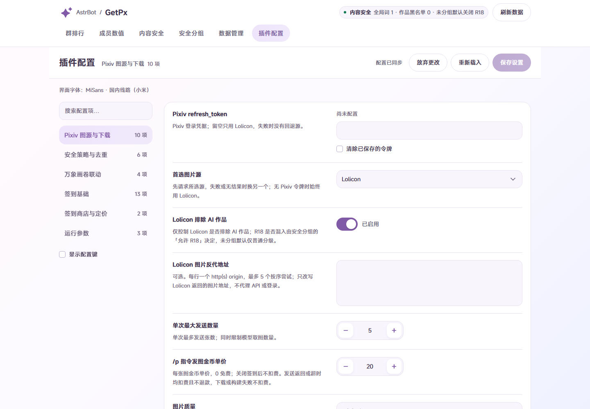

<div align="center">

# 画境拾珍


一个面向 AstrBot 的安全发图与签到插件：Lolicon/Pixiv 图片源优先级可选，请求失败或无结果时自动回退，并在 WebUI 管理群排行、成员数值、内容安全和签到数据。


<a href="https://qm.qq.com/q/cPQnFNtdN6"></a>

> 欢迎来 QQ 群 **209949919** 交流、讨论，一起玩耍！

<br>


</div>

## 目录

- [界面展示](#界面展示)
- [功能一览](#功能一览)
- [快速开始](#快速开始)
- [常用指令](#常用指令)
- [模型原生取图](#模型原生取图)
- [WebUI](#webui-插件管理中心)
- [每日签到](#每日签到)
- [OneBot 图片发送](#onebot-图片发送)
- [推荐配置](#推荐配置)
- [常见问题](#常见问题)
- [更多文档](#更多文档)
- [Roadmap](#roadmap)
- [贡献指南](#贡献指南)

## 界面展示

### 签到卡主题

| `04` · 新柳 | `05` · 荷风 |
| :---: | :---: |
|  |  |
| `06` · 丹枫 | `07` · 寒梅 |
|  |  |

签到卡支持 `省流量`（960×540）、`清晰`（1248×702）和 `极致`（1728×972）三档。`/签到主题 查看 <编号>` 可免费看预览（如 `/签到主题 查看 1`），不扣金币、不切换主题。

### WebUI 管理中心

<div align="center">

</div>

<br>

插件管理中心提供群排行与趋势图表、成员数值编辑、内容安全管理和签到数据备份功能，所有操作均通过可视化界面完成。

## 功能一览

| 场景 | 能力 |
| --- | --- |
| 搜图发图 | 按配置优先请求 Lolicon 或 Pixiv，请求失败或无结果时尝试另一个，支持数量限制，超出大小上限时换图并保留所选画质 |
| 图片来源 | 下拉选择 `Lolicon`（默认）或 `Pixiv` 优先；使用 Pixiv 需填写 `pixiv_refresh_token` |
| 内容安全 | 普通分级与安全词按群/用户独立配置；内置词开启使用内置+全局列表，关闭仅使用会话独立列表 |
| 每日签到 | H 纸张画册卡片、竖向随机背景、金币、好感度、连签、商店与主题 |
| 万象联动 | 可选接入万象画卷，签到领生图额度、商店购买额度，总开关默认关闭 |
| 管理中心 | 群排行与趋势、成员数值、安全词与黑名单、签到备份 |
| 稳定性 | 0–7 个自然日去重、发送状态诊断、临时文件自动清理 |

> 主要面向 QQ OneBot / aiocqhttp。其他平台会尽量降级为逐条发送，请自行测试兼容性。

## 快速开始

1. 在 AstrBot WebUI 插件页安装本插件：
   - 下载本仓库 zip 后选择「导入压缩包」
   - 或粘贴仓库地址：`https://github.com/shitianyaa/astrbot_plugin_get_px`
2. 默认使用 Lolicon API，无需 Token；在「首选图片源」选择 `Lolicon` 或 `Pixiv`，使用 Pixiv 作为首选或回退时填写 `pixiv_refresh_token`（[如何获取](#获取-pixiv-token)）。
3. 直接试试：

```text
/p 初音ミク 3
/签到
/签到状态
/签到日历 2026-08
/刷新背景
/签到帮助
```

标准版本不提供用于 Pixiv 登录、API 请求或图片下载的 HTTP/SOCKS 出站代理；这类网络代理请使用 [`proxy` 分支](https://github.com/shitianyaa/astrbot_plugin_get_px/tree/proxy)。如果只是 Lolicon 返回的图片地址不可用，可在 `lolicon_image_proxy_origins` 中按行填写图片反代 origin，插件只改写 Lolicon 图片 URL，不代理 API 或 Pixiv 登录。

**v3.8.8 升级说明：** 新增模型原生取图工具和随包 Skill，沿用现有群聊／私聊安全策略，无新增持久配置或数据库迁移。详见 [v3.8.8 更新日志](CHANGELOG.md#v388-2026-11-11)。

**v3.8.7 升级说明：** OneBot 发图默认使用本地路径，仅在明确文件读取失败时回退到 base64 编码重试一次，无需设置 `onebot_image_transport`。普通发图调用正常返回或发送超时均结算，超时不重发，即使最终未出图也扣费；签到与付费刷新卡片超时保留背景、缓存和占用。配置以已完成迁移的 v3.8.0 为升级基线，不再保留旧扁平兼容键；升级前请备份并阅读下方注意事项。详见 [OneBot 图片发送](#onebot-图片发送) 和 [v3.8.7 更新日志](CHANGELOG.md#v387-2026-11-07)。

> [!WARNING]
> **跨版本升级与配置／签到数据**
>
> - **先备份**插件配置 JSON 和数据目录，包括 `checkin.sqlite3`、`image_index.sqlite3` 与 `checkin_backups/`；不要删除或覆盖原数据目录。
> - **v3.8.0 及之后版本**：确认自定义配置、群聊／私聊策略已保存到六个分组后可直接升级。v3.8.7 移除旧扁平兼容键及旧去重迁移字段，AstrBot 加载 schema 时可能删除旧键，最新版无法在裁剪后补迁移。
> - **早于 v3.8.0**：先安装 [v3.8.0](https://github.com/shitianyaa/astrbot_plugin_get_px/releases/tag/v3.8.0)，成功启动并确认分组配置保存，再升级到 v3.8.7。
> - **v2.8.x 或已有数据但数据库没有 schema 版本号**：先使用 [v3.0.0](https://github.com/shitianyaa/astrbot_plugin_get_px/releases/tag/v3.0.0) 完成签到数据迁移，再经过 v3.8.0 完成配置迁移；不要直接跳到最新版。
> - **数据库 schema3**：v3.8.7 保留旧群策略迁移。插件先保存配置，再备份数据库并将 `user_version` 收敛为 2，保留 `group_content_safety` 表与历史行；配置保存或备份失败时不修改旧数据库。
>
> 签到卡缓存可能在升级后重建，不重复发奖，也不会因此清空签到记录。

> [!IMPORTANT]
> **关于 T2I 渲染服务**
>
> 签到卡片依赖 AstrBot T2I（HTML 转图片）。公共 T2I 常有海外节点、体积限制或 SSL 问题，**强烈建议自建**。
>
> - 自部署文档：[AstrBot T2I 服务部署指南](https://docs.astrbot.app/others/self-host-t2i.html)

签到卡和日历的大背景会在内联前缩放、重编码：卡片最长边不超过 1920px，日历不超过 2880px，编码后背景不超过 1.5MB。高细节图片会进一步缩小，透明度、EXIF 方向和 ICC 色彩按原图处理；小图保持原始字节。签到背景无法编码时使用占位图，不保留被拒绝作品的署名、说明或去重占用。此预算不包含模板和字体，不能消除端点过载导致的超时。细节见 [T2I 渲染说明](docs/dev/t2i-rendering.md)。

签到卡头像在本地下载、校验后以 data URL 内联，获取失败时显示昵称首字；同一次画质降级复用已准备的头像与背景，缓存命中不下载头像。

## 常用指令

| 指令 | 说明 | 示例 |
| --- | --- | --- |
| `/p [标签] [数量]` | 按标签搜索发图（正常返回或发送超时按张扣金币，`p_coin_cost` 可配，0 为免费） | `/p 初音ミク 3` |
| `/p [数量]` | 无标签时随机发图（同上费用规则） | `/p 5` |
| `/签到` | 每日签到 | `/签到` |
| `/签到状态` | 金币、好感、连签等 | `/签到状态` |
| `/签到日历 [YYYY-MM]` | 个人月度签到日历图 | `/签到日历 2026-08` |
| `/签到排行 今日\|月榜\|连签\|累计` | 当前群的签到排行 | `/签到排行 月榜` |
| `/签到商店 查看` | 加持、背景刷新、生图额度 | `/签到商店 查看` |
| `/签到主题 查看 <编号>` | 免费主题预览 | `/签到主题 查看 1` |

签到功能按平铺高频指令 + 小组组织：

```text
/签到状态、/签到成就、/签到日历 [YYYY-MM]、刷新背景
签到生日：查看、设置、清除
签到称号：查看、佩戴
签到排行：今日、月榜、连签、累计
签到商店：查看、加持、生图
签到主题：列表、查看、购买、切换
签到管理：预览、导出、事件查看/添加/删除
```

完整指令（含商店购买、生日、成就、管理员事件/导出等）见 [指令参考](docs/user/commands.md)。

> 指令名如与其他插件冲突，可在 AstrBot Dashboard 的指令管理（`alter_cmd`）中调整对应指令的权限或停用状态。
> 文档使用默认前缀 `/`；实际可替换为 AstrBot `wake_prefix` 中配置的 `.`、`。` 等前缀。

## 模型原生取图

模型可调用 `get_px_image` 直接向当前聊天发送图片，调用 `get_px_artworks` 查询公开作品与候选、`get_px_users` 查询作者，调用 `get_px_context` 只读当前用户余额与取图限制。四个工具不依赖 MCP。

取图支持随机／标签、明确 Pixiv 搜索、推荐、榜单、作者、关联作品及作品 ID／链接的指定单页。普通请求直接发图，按需查询候选；公开查询免费，不下载、不扣费、不占去重。Pixiv 查询支持真实续查，Lolicon 只是随机取样。除默认模式外需配置 Pixiv 认证，失败不跨源替代；参数与结果说明集中在下方 Skill。

随包 [get-px-image Skill](skills/get-px-image/SKILL.md) 提供调用说明；AstrBot 需要支持插件 Skill 自动发现。旧版无法读取 Skill 时仍可使用原生工具及其参数描述。

- 默认逐张直发；用户明确要求时可用 `send_mode=forward` 合并转发（仅 OneBot），`auto` 沿用配置阈值。
- `tag` 最多 48 字符，只传短标签或确定的单一语言角色名，不自动扩写。普通取图的 `count` 省略为 1，明确数量按用户要求传入；指定作品按合并目标数执行。管理员数量上限默认 5，实际执行受配置与余额限制。
- 可按本次要求指定方向、宽高比及容差、最小像素宽高和 `max_size_mib`；元数据粗筛后核对实际文件尺寸，大小上限只能收紧，不换画质、不放宽筛选。
- 沿用当前图源、限频、去重、安全策略和收费规则。收费时余额只够部分张数会缩减，余额读取失败拒绝；免费时不查询钱包。
- 正常取图不发送账单；余额不足、数量缩减及跨低余额阈值时给出提醒。`/p` 仍保留原有账单。
- 数量缩减时工具返回 `requested_count`、`effective_count`、`max_count`、`count_limits` 和原因提醒，区分配置上限、余额限制与实际候选不足，不根据少取推断标签失效。
- 同一消息事件只执行一次发送，查询可在发送前串联；追加取图需另发消息。明确指定作品可重取已完成历史，但仍保留在途占用。工具不返回图片直链或路径，查询可返回公开作品／作者页链接；下载数量不等于送达数量，送达未知不补发。

作品查询可通过 `include_stats=true` 补查点赞、收藏与浏览量，供模型在本批候选中选择热门图；未知计数不填零。用户未明确要求时禁止主动视觉识图，不把热度当作画面质量。

## WebUI 插件管理中心

AstrBot WebUI 插件页的「pluginCenter」可：

- 按群查看今日 / 月度 / 连签 / 累计排行与 7/30 天趋势
- 搜索成员并调整金币、好感度、累计与连续签到当前值
- 维护自定义屏蔽词与作品 ID 黑名单
- 下载 / 上传签到备份（导出 schema v7，并兼容导入 schema v6）

成员数值编辑只改当前资料，不回写历史奖励、群排行或已生成卡片。

## 每日签到

- 奖励全局一天一次；群榜按实际签到的群分别记录，不重复发金币。
- 重复签到不重奖，按实际生效的安全规则复用当天卡片：相同规则跨群共享，不同规则分别保留；返回原群仍使用其缓存卡片。
- 商店：加持 200/500/1000；背景刷新默认 100（可配）；非默认主题默认每套 1500（可配）。默认「米白」免费。

细则（好感等级、卡片规格、问候 24/32 字、生日事件、称号、节假日等）见 [签到说明](docs/user/checkin.md)。

## 万象画卷联动

本插件可选接入 [万象画卷](https://github.com/diaomin66/astrbot_plugin_omnidraw/)（`astrbot_plugin_omnidraw`），用签到金币体系购买和管理每日生图额度。总开关 `checkin_omnidraw_link_enabled` 默认关闭，开启后才会检测对方插件并激活全部联动功能。

- **签到领额度**：`/签到` 时自动为万象画卷当日生图额度增加随机 1–3 张（读取对方 `checkin_bonus_min/max` 配置），与对方 `/签到` 双向幂等，本插件 `stop_event` 自动屏蔽对方同名指令，无需手动禁用。
- **商店购买**：`签到商店 生图 [张数]` 按张定价（`checkin_omnidraw_quota_cost`），受每日购买上限（`checkin_omnidraw_quota_daily_max`）约束，发放失败自动退回金币。
- **状态展示**：`/签到状态` 展示剩余/已用/加成额度，桥不可用时不显示。
- **额度有效期**：当日有效，万象画卷跨天时自动清零，不结转。
- **前置条件**：需同时安装万象画卷并启用其每日生图限制；对方版本过旧或私有成员不兼容时自动降级为"不可用"，不影响签到本身。

> 联动通过读取万象画卷运行时实例的私有成员实现，无公开 API 契约。对方升级改了内部结构时联动会静默降级，届时需适配。

## OneBot 图片发送

`/p` 和模型取图在 OneBot 上默认使用本地路径，仅在明确文件读取失败时自动回退，无需选择传输方式：

- 默认直接调用 OneBot，使用本地 `file:///` URI；POSIX 图片发送前设置 `0644` 权限。
- 明确报文件不存在或无法读取时，将同一条消息回退到 base64 编码，再尝试一次。日志保留脱敏异常、切换原因及重试结果。
- 发送调用正常返回即按已发送扣费和记录去重，不要求回执包含 `message_id`；file 路径发送缺少该字段时保留图片 10 分钟，不重发。
- 发送超时（包括协议返回的 `Timeout: NTEvent … sendMsg`）仍按已发送扣费和记录去重，不自动重发。图可能稍后出现；即使最终未出图，该次仍扣费。
- 下载或构建失败不扣费；其他发送异常保留未知状态，不扣费、不重发。发送异常与构建失败只记日志，不向聊天补发失败或不扣费提示。正常的金币结算消息保留。

base64 是图片编码，与 AstrBot 4.27.3 的 OneBot 默认发图编码相同；本插件回退时仍直接调用 OneBot，不额外尝试 AstrBot 框架发送。

旧 `onebot_image_transport` 已从 schema 删除，由 AstrBot 在加载配置时裁剪，运行时统一使用自动策略；插件不依赖旧键，也不能恢复框架已裁剪的值。其他平台沿用 AstrBot 发送链路。每日签到与付费刷新生成的签到卡也复用自动传输和超时判断：超时或送达未知仅记日志，不补纯文字；提交期间取消同样保留已保存的背景、签到卡与去重占用，确定构建失败或提交前取消才释放未提交资源。签到奖励与刷新价格规则不变。签到测试预览、主题预览和日历仍沿用各自的框架发送流程。

下载临时文件位于 `StarTools.get_data_dir("astrbot_plugin_get_px")` 下的 `temp/`。带有效 `message_id` 的正常返回、base64 正常返回或构建失败后及时删除；OneBot file 正常返回但缺少 `message_id`、发送超时、其他未知状态或提交期间取消时保留 10 分钟，让协议端完成读取，再自动清理。插件重启后恢复剩余保护时间；Pages 清理也跳过最近 10 分钟的下载文件。分容器部署建议共享相同绝对路径，读不到文件时由 base64 回退处理。

### Docker 文件互通排查

需要借助 AI 检查容器挂载时，可复制以下提示词：

> 请检查 Docker 中 AstrBot 与 SnowLuma/NapCat 的文件互通：将 AstrBot 的数据目录只读挂载到协议端，确保两端容器内绝对路径完全一致，并验证 QQ 进程的实际 UID 能读取图片。修改前检查现有部署，重建时保留全部参数；不要递归 chmod、修改运行用户或扩大目录权限。

## 推荐配置

| 配置 | 建议 |
| --- | --- |
| `preferred_image_source` | 默认 `Lolicon`；有 Pixiv Token 时可改选 `Pixiv` 优先 |
| `pixiv_refresh_token` | 使用 Pixiv 作为首选或回退时填写；留空直接使用 Lolicon |
| `image_quality` | 省流量用 `large`，优先原图用 `original` |
| `forward_threshold` | 仅 aiocqhttp：`0` 始终合并转发；`1` 表示超过 1 张图才合并转发 |
| `checkin_card_quality_tier` | 默认 `省流量`，日常推荐 `清晰`；签到卡三档为 960×540／1248×702／1728×972，日历三档为 1600×900／2080×1170／2880×1620 |
| `dedupe_days` | 默认 `1`，只去重北京时间当天；`2–7` 扩大自然日窗口，`0` 关闭；不同会话、标签和图源仍隔离 |
| `lolicon_image_proxy_origins` | 图片地址无法访问时再配置；每行一个 http(s) origin |

<details>
<summary>完整配置项</summary>

WebUI 配置页按以下 6 组折叠展示，分组细节与维护规则见 [docs/project/configuration.md](docs/project/configuration.md)：Pixiv 图源与下载、图片筛选与去重、万象画卷联动、签到基础、签到商店与定价、运行参数。

| 配置 | 说明 | 默认值 |
| --- | --- | --- |
| `pixiv_refresh_token` | 使用 Pixiv 作为首选或回退时需要填写；留空直接使用 Lolicon | 空 |
| `preferred_image_source` | 下拉选择 `Lolicon` / `Pixiv`；请求失败或无结果时尝试另一源 | `Lolicon` |
| `lolicon_exclude_ai` | 请求 Lolicon 时排除 AI 作品；R18/普通混合由当前会话强制普通分级决定 | `true` |
| `lolicon_image_proxy_origins` | 可选 Lolicon 图片反代 origin，多行按顺序轮换；不代理 API 或 Pixiv 登录 | 空 |
| `filter_manga` | 过滤 Pixiv 结果中的漫画作品 | `true` |
| `max_count` | 命令和模型工具共用的单次数量上限，范围 1-20；沿用已保存的配置 | `5` |
| `p_coin_cost` | 命令和模型工具共用的每张金币，范围 `0–200`；`0` 免费；正常返回与发送超时均结算，其他发送异常不扣费 | `20` |
| `dedupe_days` | 最近 `0–7` 个北京时间自然日去重；同群共享，不同会话、标签和图源隔离；`0` 关闭并清空使用记录 | `1` |
| `group_content_safety_policies` | 群聊内容安全策略列表：强制普通分级、内置安全词开关与独立屏蔽词/作品 ID 黑名单，按群 ID 生效；配置页或管理中心均可维护 | `[]` |
| `private_content_safety_policies` | 私聊内容安全策略列表：字段同群聊策略，按用户 ID 独立生效；配置页或管理中心均可维护 | `[]` |
| `request_timeout` | 单张图片下载超时，单位秒 | `30` |
| `image_quality` | 图片质量：`original`、`large`、`medium` | `original` |
| `auto_downgrade_original_mb` | 普通发图超过该大小时换作品，单位 MiB；沿用旧键与已有数值；`0` 关闭软上限 | `10.0` |
| `forward_threshold` | 命令使用；模型工具仅 `send_mode=auto` 使用。仅 aiocqhttp：成功下载图片数严格大于此值时合并转发；`0` 始终合并转发，`1` 表示超过 1 张才合并转发；其他平台自动逐条发送 | `1` |
| `checkin_enabled` | 签到开关 | `true` |
| `checkin_bot_name` | 签到卡片中的 bot 角色名 | `neko` |
| `checkin_background_mode` | 签到背景模式：`pixiv_daily` 或 `custom`；自定义背景不可用时继续尝试在线图片源 | `pixiv_daily` |
| `checkin_background_refresh_cost` | 用户更新当天在线背景所需金币；范围 `0–300`，`0` 为免费 | `100` |
| `checkin_theme_cost` | 非默认签到主题的统一价格；范围 `0–5000`，`0` 为免费 | `1500` |
| `checkin_omnidraw_link_enabled` | 万象画卷联动总开关，默认关闭；开启后才会启用签到商店出售生图额度、签到发放额度、`/签到状态` 展示额度等全部联动功能 | `false` |
| `checkin_omnidraw_quota_cost` | 签到商店购买生图额度的单张价格；范围 `0–300`，`0` 为免费；购买时指定张数，实际花费 = 单价 × 张数 | `75` |
| `checkin_omnidraw_quota_default` | 商店购买生图额度不指定张数时的默认购买张数；范围 `1–50` | `1` |
| `checkin_omnidraw_quota_daily_max` | 每人每天商店购买生图额度上限，范围 `0–30`；`0` 不限，签到赠送不受此限 | `10` |
| `checkin_background_tag` | 签到背景标签；留空按所选优先级请求 Lolicon 随机或 Pixiv 推荐作品 | 空 |
| `checkin_custom_background` | 本地图片路径；默认主题按竖向作品相框完整显示 | 空 |
| `checkin_avatar_enabled` | 签到卡片显示用户头像 | `true` |
| `checkin_card_quality_tier` | 签到卡画质：`省流量` / `清晰` / `极致`；日历使用同名档位，但输出尺寸不同；预览和刷新背景立即生效，普通重复签到保持当天档位 | `省流量` |
| `checkin_greeting_mode` | 签到问候来源：`local` / `hitokoto` / `ai` | `hitokoto` |
| `checkin_hitokoto_categories` | 一言类型中文多选；选择“全部”或留空时从全部分类随机 | `全部` |
| `checkin_ai_greeting_provider_id` | 签到问候文本模型；留空时尝试当前会话模型，仍不可用则使用本地文案 | 空 |
| `checkin_ai_greeting_prompt` | 自定义角色和语气；固定安全约束由插件以 system prompt 追加 | 见配置页 |
| `checkin_ai_greeting_timeout` | 单次问候模型调用超时秒数；失败后回退本地文案 | `8.0` |
| `checkin_hitokoto_timeout` | 一言 API 请求超时秒数；失败后回退本地文案 | `5.0` |
| `rate_limit_seconds` | 同一用户请求频率限制，单位秒；`0` 为禁用 | `3` |
| `webui_font_source` | WebUI 字体来源：`mirror`、`official`、`none` | `mirror` |

</details>

`preferred_image_source` 保存并重载后生效，普通发图、签到与日历背景共用此顺序。首选请求失败或返回空结果时尝试另一源；已有候选被过滤、去重或下载失败不触发换源。有效的签到／日历缓存与已保存背景仍按原规则复用，不因切换优先级强制重选。

Lolicon 请求地址固定为 `https://api.lolicon.app/setu/v2`，旧 `lolicon_api_url` 已删除；旧自定义地址及留空停用不再生效。图片反代配置仍保留，但不代理 API 请求。

## 会话内容安全策略

群聊和私聊策略按群 ID / 用户 ID 独立持久化，包含普通分级、内置安全词、独立自定义屏蔽词和独立作品 ID 黑名单。
独立屏蔽词保留连字符等标点，因而 `r18g` 与 `r-18g` 可分别保存；全角/半角及大小写等价项仍会判重，实际匹配继续忽略常见分隔符。

- **启用内置安全词开启**：使用内置安全词 + 内容安全页全局自定义屏蔽词/作品黑名单，忽略当前会话独立列表。
- **启用内置安全词关闭**：停止以上三类全局约束，仅使用当前会话独立自定义屏蔽词和独立作品 ID 黑名单。
- 独立列表可分别应用到所有群聊策略、所有私聊策略或全部策略；批量操作只覆盖对应字段并失败回滚。缺少会话上下文、策略不存在或读取异常时严格默认普通分级与内置安全词。

## 常见问题

### 为什么设置了原图，发出来仍然模糊？

普通 `/p` 和模型取图固定使用 `image_quality` 指定的画质，不在插件内压缩或自动换成低档图片。选择 `original` 时，原图超过大小上限、地址缺失或下载失败会跳过该作品，再找另一张。

“图片大小上限”默认 **10 MiB**，适用于所选的所有画质；配置键仍为 `auto_downgrade_original_mb`，升级后沿用已有数值。先尝试同批剩余候选，不足时补取，每次请求最多取 **3 批**、实际尝试 **20 张作品**；相同作品 ID 在本次请求内只尝试一次。到达上限后发送已找到的图片，没有可用图片则提示失败；超限或下载失败的候选不扣费、不记成功使用。

**升级提醒：** 旧配置中的 `3.0` 会继续生效；使用原图且频繁因大小限制换图时，建议手动把“图片大小上限”调到 **10 MiB**。自定义数值不会被升级覆盖。

**希望保留原图：** 设置 `image_quality=original`。可调大大小上限或设为 `0`，保存后重载；`0` 关闭软上限，单张下载仍受 **50 MiB** 硬上限约束。较大的原图会增加下载流量和等待时间。

查看日志中的“图片下载完成”及最终 `quality`；调试日志中的 `reason=size_limit` 表示因超限跳过作品。设置原图后仍模糊时，可检查原作品本身的分辨率，以及客户端是否展示预览图。

命令首次取源不计入下载预算，下载与补取的等待预算为 `request_timeout × max(3, 实际执行张数)` 秒，张数按数量上限限制后的值计算。模型工具首次取源也受框架预算限制；后续下载与补取使用框架选图截止时间和上述下载阶段截止时间中较早者，执行张数还受余额限制。到期取消进行中的下载或补取，发送已有图片。预算边界见[配置说明](docs/project/configuration.md)。

以上配置只针对普通发图。签到卡与日历使用独立的 `checkin_card_quality_tier`，不要用普通发图阈值调整它们的画质。

### Lolicon 图片反代如何填写？有哪些常用地址？

Lolicon API 返回作品信息和各档图片 URL，插件筛选后直接下载；图片反代只替换 URL 的协议和主机，保留作品路径与画质档位，不重新选图，不代理 Lolicon API 或 Pixiv 登录，也不负责提高画质。

在 `lolicon_image_proxy_origins` 中**一行一个完整 origin**，最多 5 个，按填写顺序尝试；不可用再尝试 API 返回地址，受单图总共 8 次下载预算限制。只填协议、域名和可选端口，不填路径、作品 ID 或 `{{path}}`；保存后重载。只对 Lolicon 来源且位于支持列表中的图片主机改写。

| 地址 | 服务方地区建议 | 本机直连实测 | 本机走海外 HTTP 代理实测 |
| --- | --- | --- | --- |
| `https://i.pixiv.re` | 大陆优先，海外也可尝试 | 下载中途超过 30 秒 | 成功，2.09 秒 |
| `https://i.pixiv.nl` | 大陆备用，海外也可尝试 | 下载中途超过 30 秒 | 下载中途超过 30 秒 |
| `https://i.pixiv.cat` | 海外优先，大陆直连不推荐 | HTTP 500 | HTTP 500 |
| `https://i.muxmus.com` | 未明确限制地区，需实测 | 成功，10.54 秒 | 成功，3.98 秒 |

地区建议来自 [Pixiv.cat 反代说明](https://pixiv.cat/reverseproxy.html)；[木辛木杉服务](https://i.muxmus.com/) 提醒节制使用、不要用于爬虫。公共服务可能限速或停服，请使用可信服务；旧教程中的 `i.yuki.sh` [已停止服务](https://blog.yuki.sh/posts/599ec3ed8eda/)。


## 更多文档

| 文档 | 内容 |
| --- | --- |
| [指令参考](docs/user/commands.md) | 全部指令与纯文本签到 |
| [签到说明](docs/user/checkin.md) | 发奖、商店、好感、卡片、问候、生日事件与称号 |
| [项目架构](docs/project/architecture.md) | 模块划分（开发用） |
| [缓存与去重](docs/project/cache-and-dedupe.md) | 缓存身份、有效期、去重范围、失败与清理边界 |

**去重与复用：** 普通发图、首次签到和刷新背景在相同会话、图源与标签内共享使用记录；跨会话或跨标签抽到同图属于现有规则允许的情况，不是用户全局去重。重复签到则有意复用当天卡片；日历背景只优先避重，不占正式去重池。

**数据简述：** 发图去重窗口与签到数据保存在插件数据目录；发送临时图及时清理，未知路径发送延迟 10 分钟清理；签到 JPEG 缓存按天自过期，不会整目录清空数据库、黑名单或备份。

AI 签到问候会向所选 AstrBot 文本模型发送可用昵称、日期、签到统计、关系阶段、奖励、称号和成就；不会把用户 ID 当作昵称发送，昵称不可用时使用“匿名用户”。模型异常、错误角色或输出不合规时使用已保存的本地问候。

## Roadmap

以下是我们关注的方向，欢迎按此提交 issue 或 PR（详情见 [贡献指南](#贡献指南)）。

| 方向 | 说明 | 状态 |
| --- | --- | --- |
| 商店经济扩展 | 补签卡、发图券、好感度出口、每日特惠，让金币形成闭环 | 待讨论 |
| 内容与体验 | 更多签到主题、卡片挂件、自定义称号 | 待讨论 |
| 稳定与可观测 | 更细的失败日志、插件自检、性能回归 | 持续 |
| 社区协作 | issue/PR 规范、路由贡献方向 | 已启动 |

> 具体需求、进度与讨论见 [GitHub Issues](https://github.com/shitianyaa/astrbot_plugin_get_px/issues)。

## 贡献指南

欢迎提交 issue 和 PR。贡献前请先阅读 [docs/dev/contributing.md](docs/dev/contributing.md)，了解改动边界、提交规范和文档同步要求。

**提 issue**

- **Bug**：使用 [Bug 模板](https://github.com/shitianyaa/astrbot_plugin_get_px/issues/new?template=bug_report.md)，附上插件版本、AstrBot 版本、复现步骤和脱敏日志。
- **功能建议**：使用 [Feature 模板](https://github.com/shitianyaa/astrbot_plugin_get_px/issues/new?template=feature_request.md)，说明目标场景和与现有功能的关联。

**提 PR**

- 使用 [PR 模板](https://github.com/shitianyaa/astrbot_plugin_get_px/compare)，说明改动范围、验证方式和兼容性。
- PR 前请确保本地通过 `python -m pytest tests` 与语法检查（见 [docs/dev/testing.md](docs/dev/testing.md)）。
- 代码改动导致文档失真时，请在同一个 PR 中同步更新 README 与 docs。

## 获取 Pixiv Token

Pixiv 可用于首选／回退取图及榜单、作者、关联和指定作品等明确模式。使用 [piglig/pixiv-token](https://github.com/piglig/pixiv-token) 获取 `refresh_token`，填入 `pixiv_refresh_token`。该工具基于 Playwright 自动完成 Pixiv OAuth 登录并取回 token，按仓库说明运行即可。

## 依赖

```text
pixivpy-async
aiohttp
Pillow
lunar-python
```

## 致谢

- 默认图片源由 [Lolicon API](https://api.lolicon.app/) 提供
- Pixiv 图片源基于 [pixivpy-async](https://github.com/Mikubill/pixivpy-async)
- Pixiv `refresh_token` 获取方案来自 [piglig/pixiv-token](https://github.com/piglig/pixiv-token)，感谢 [piglig](https://github.com/piglig) 提供基于 Playwright 的 OAuth 自动取码工具
- 作品黑名单缩略图生成基于 [Pillow](https://python-pillow.org/)
- 签到每日一言由 [Hitokoto API](https://github.com/hitokoto-osc/hitokoto-api) 提供，感谢一言开源社区和公共 API 服务
- 签到卡片内置字体由 [霞鹜文楷轻便版](https://github.com/lxgw/LxgwWenKai-Lite) 生成，采用 SIL Open Font License 1.1 授权
- 每日签到设计参考 [zhenxun_bot](https://github.com/zhenxun-org/zhenxun_bot)
- 万象画卷联动接入 [astrbot_plugin_omnidraw](https://github.com/diaomin66/astrbot_plugin_omnidraw/)（作者 雪碧bir），生图额度由对方插件管理
- 跨插件联动桥接模式参考 [astrbot_plugin_private_companion](https://github.com/menglimi/astrbot_plugin_private_companion)（作者 menglimi），感谢其私有成员探测与降级策略的设计启发
- [PeeGayhub Telegram 表情包系列](https://t.me/addstickers/PeeGayhub)：插件图标借鉴了该系列表情包风格；图标素材由 GPT 生成。
