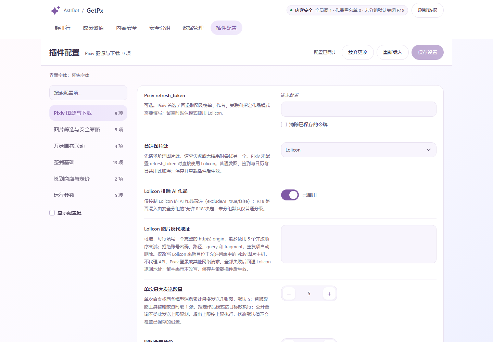

<div align="center">

# 画境拾珍


AstrBot 图片与签到插件，支持 Lolicon / Pixiv 搜图、模型取图、每日签到和金币商店。


<a href="https://qm.qq.com/q/cPQnFNtdN6"></a>

> 欢迎来 QQ 群 **209949919** 交流、讨论，一起玩耍！

<br>


</div>

## 目录

- [快速开始（安装、升级、Pixiv Token 获取）](#快速开始)
- [图片获取（指令、模型取图、收费）](#图片获取)
- [签到与商店（每日签到、主题、金币、万象画卷联动）](#签到与商店)
- [管理与配置（WebUI、常用配置、内容安全）](#管理与配置)
- [常见问题（图片画质、下载失败、反代设置）](#常见问题)
- [更多文档（完整指令、配置说明、更新日志）](#更多文档)

## 快速开始

### 安装与首次使用

1. 在 AstrBot WebUI 插件页安装，粘贴仓库地址：`https://github.com/shitianyaa/astrbot_plugin_get_px`；也可下载仓库 zip 后选择「导入压缩包」。
2. 默认使用 Lolicon，无需 Token。需要 Pixiv 搜索、榜单或作者作品时，填写 `pixiv_refresh_token`（[获取方法](#获取-pixiv-token)）。
3. 向 Bot 发送：

```text
/p 初音ミク 3
/签到
/签到状态
/签到日历 2026-08
/刷新背景
/签到帮助
```

主要支持 QQ OneBot / aiocqhttp，其他平台需自行测试兼容性。

签到卡和日历依赖 AstrBot T2I 渲染服务。公共服务不稳定时，建议[自行部署 T2I](https://docs.astrbot.app/others/self-host-t2i.html)。

全部指令见[指令参考](docs/user/commands.md)。文档使用默认前缀 `/`，可替换为 AstrBot 配置的其他唤醒前缀；指令冲突可在 AstrBot 指令管理中调整。

### 获取 Pixiv Token

使用 Chrome / Edge 浏览器扩展 [pixiv-token-extension](https://github.com/shitianyaa/pixiv-token-extension)：

1. 按扩展仓库说明安装；从源码加载时选择其中的 `extension` 文件夹。
2. 在浏览器登录 Pixiv，点击扩展图标，等待获取 Token。
3. 复制 `refresh_token`，填入本插件配置的 `pixiv_refresh_token`，保存并重载。

### 升级提醒

> [!WARNING]
> 升级前备份插件配置和数据目录。早于 v3.8.0 的版本须先升级到 v3.8.0 并确认配置迁移成功；v2.8.x 或已有数据库无版本号时，还须先经过 v3.0.0 完成数据迁移。新代理地址默认留空，仍使用直连；图片去重改为固定窗口，不再提供期限配置。详见[配置升级基线](docs/project/configuration.md#升级基线)及[本次版本说明](CHANGELOG.md#v388-2026-11-15)。

## 图片获取

### 指令取图

| 指令 | 说明 |
| --- | --- |
| `/p 初音ミク 3` | 按标签取 3 张图片 |
| `/p 5` | 随机取 5 张图片 |
| `/pd 152067485 1` | 下载并发送指定作品的第 1 页，页码可省略 |
| `/pr 周 3` | 按周榜顺序发送 3 张，也支持日／月或 day／week／month |

`/p` 统一随机与组合搜索，按配置优先级选择图源，Pixiv 与 Lolicon 均保持空格 AND 条件；Lolicon 最多支持3个 AND 条件，超过时只尝试可用的 Pixiv，不删除条件。`/pd`、`/pr` 需要 Pixiv Token，不跨源回退。指令与模型工具共用筛选、下载、发送和结算，沿用命令合并阈值和聊天账单；数量默认1，`/pd` 的可选数字是页码。详见[指令参考](docs/user/commands.md)。

### 模型原生取图

普通取图的已用历史和在途占用在当前群／私聊内有效10分钟；签到／刷新背景对应记录独立保留最近2个北京时间自然日。普通与签到的分页位置分别保存，统一保留滚动24小时，不延长图片去重期限。当前页还有候选时保留位置，本页耗尽后再翻页；最后一页耗尽后，下次从首页开始。Pixiv 推荐保留原始书签游标和已浏览列表，避免将不同账号的推荐翻页信息误判为无效。到期自动失效，无需重载。重开模型对话不清空这些记录。

升级到本版后首次加载，会一次性清空旧图片去重／占用记录及全部分页键，包括签到背景的图片去重；此前发过的图可能再次抽中。正式签到记录、金币、安全配置和卡片缓存保留。完成标记保存在图片索引数据库中，保存配置、重载或重启不会重复清空。已完成切换的版本1图片索引会先备份，再增加真实续页参数列并升至版本2，保留已有使用记录和分页位置。

和模型聊天时，可以这样说：

- 「来三张初音ミク的竖图」
- 「发一张白子，限定蔚蓝档案」或「发一张洛茜的白丝图」
- 「看看 Pixiv 最新周榜」
- 「把这个作品链接的第 2 张发给我」
- 「查一下这个作者有哪些作品」

插件提供取图、作品查询、作者查询和余额查询四个原生工具。搜索、推荐、榜单、作者、关联作品和指定作品模式需要 Pixiv Token；默认模式沿用配置的图源优先级。

组合搜索支持空格连接的多个关键词，如 `洛茜 黑丝`，表示同时匹配；`auto` 保留图源优先级和随机挑选，`search` 固定 Pixiv 并保持时间顺序。搜索命中依赖元数据，不代表看过画面。

公开查询免费，支持标签及标题／简介关键词检索；搜索默认最新发布在前，不支持 Pixiv 服务端热门排序。可按需补查点赞、收藏和浏览量，失败保留已知统计，未知不当作零。用户要热门图时，模型可比较本批已知热度，再按选定顺序指定发送；这不代表标签热门搜索结果。“看看日榜／周榜”只查询，“发几张周榜图”才发图。未明确要求时禁止主动识图，不凭统计数据评价画面质量。

取图沿用数量上限、余额、画质和安全规则，支持方向、比例、像素和文件大小筛选。普通列表发送按近期历史去重；只读查询不排除已发送历史，指定作品允许重取完成历史，仍检查在途占用。查询不预留发送数量或金币，指定目标失败不换作品补齐。默认逐张发送，可明确要求 OneBot 合并转发；正常取图不发账单，数量缩减或余额不足时会提醒。同消息可为不同角色或条件分别取图，共享总张数、发送限频准入和等待预算；已提交或送达未知的任务不重复发送，确定未提交时按工具提示重试。同一用户跨消息的收费取图进行中时，新请求直接提示繁忙，不排队、不扣费、不消耗发图名额；免费取图及其他用户不受此限制。

随包 [get-px-image Skill](skills/get-px-image/SKILL.md) 包含完整调用说明；需要 AstrBot 支持插件 Skill 自动发现。旧版无法读取 Skill 时，仍可使用原生工具及其参数描述。消息需要进入模型对话且工具可用，实际是否调用取决于模型；不使用模型时可直接用 `/p`。

#### 与生图插件同时使用

同时安装生图插件时，模型可能把「找图」「发张图」理解为生成新图片，转而调用其他插件的生图工具。可在当前人格提示词中加入：

```text
只有用户明确要求生成或创作新图片，例如“生图”“画图”“画一张”或让你“自拍”时，才调用生图插件的工具。
用户说“找图”“搜图”“发张角色图”“来张插画”等时，默认表示查找或发送已有作品，使用画境拾珍 get_px 的工具：直接发图调用 get_px_image，需要先查询或挑选候选时调用 get_px_artworks。
```

这是给模型的工具选择提示，不会修改其他插件或强制接管工具调用；手动取图仍可使用 `/p`、`/pd` 和 `/pr`。

### 收费说明

签到功能开启且 `p_coin_cost` 大于 `0` 时，普通发图按张收费，默认每张 **20 金币**。关闭签到功能或将单价设为 `0` 时取图免费。收费时，发送调用正常返回或超时均扣费；超时不重发，即使最终未出图也扣费。下载、构建失败及其他发送异常不扣费。

## 签到与商店

### 每日签到

| 指令 | 说明 |
| --- | --- |
| `/签到` | 每日签到，领取金币和好感度 |
| `/签到状态` | 查看金币、好感度和连签 |
| `/签到日历 [YYYY-MM]` | 查看个人月度签到日历 |
| `/签到排行 今日\|月榜\|连签\|累计` | 查看当前群排行 |
| `/签到商店 查看` | 查看加持、背景刷新和生图额度 |
| `/签到主题 查看 <编号>` | 免费预览主题 |
| `/刷新背景` | 付费更换当天签到背景 |

也可直接发送纯文本「签到」。每天领取一次奖励，在不同群签到会分别记录群榜，不重复发金币。重复签到复用当天卡片；安全规则不同的聊天分别缓存。

金币可用于加持、刷新背景和购买主题。背景刷新默认 **100 金币**，非默认主题每套 **1500 金币**，均可配置；默认「米白」免费。生日、称号、问候等用法见[签到说明](docs/user/checkin.md)。

### 签到卡主题

| `04` · 新柳 | `05` · 荷风 |
| :---: | :---: |
|  |  |
| `06` · 丹枫 | `07` · 寒梅 |
|  |  |

签到卡支持 `省流量`（960×540）、`清晰`（1248×702）和 `极致`（1728×972）三档。`/签到主题 查看 <编号>` 可免费看预览（如 `/签到主题 查看 1`），不扣金币、不切换主题。

### 万象画卷联动

同时安装[万象画卷](https://github.com/diaomin66/astrbot_plugin_omnidraw/)并启用其每日生图限制后，可开启 `checkin_omnidraw_link_enabled`：

- 签到领取生图额度，默认随机 1–3 张，实际按万象画卷配置发放；两边签到不会重复领取。
- 用 `签到商店 生图 [张数]` 购买额度，发放失败退回金币。
- 在 `/签到状态` 查看额度；额度当日有效，跨天清零。

联动默认关闭，对方插件不可用或版本不兼容时，不影响签到。价格和每日购买上限见[联动配置](docs/project/configuration.md#3-万象画卷联动checkin_omnidraw)。

## 管理与配置

### WebUI 插件管理中心

<div align="center">

</div>

上图为管理中心配置页，使用本地演示数据。

<br>

在 AstrBot 插件详情页打开「画境拾珍」管理中心，可以查看群排行和趋势、调整成员金币与好感度、管理安全分组、导出和导入签到备份，并在「插件配置」按六组导航或搜索设置。界面支持明暗主题、移动布局和键盘操作。

设置只保存改动项；失败保留草稿，不自动重载插件。Pixiv Token 和出站代理地址仅显示是否配置，留空保留，清除需显式勾选；安全规则在专用页面维护。代理、Token 及客户端配置保存后需重载。管理中心使用访问设备的系统字体，无需下载。没有新增好感度金币加成或签到奖励配置。

成员资料每页显示 20 位。搜索或清除条件后回到第一页，编辑后留在当前页。修改成员数值只影响当前资料，不回写历史奖励、群排行或已生成卡片。

### 常用配置

| 配置 | 用法 |
| --- | --- |
| `preferred_image_source` | 默认 `Lolicon`，可改为 `Pixiv` 优先；首选请求失败或无结果时尝试另一源，无 Token 时只用 Lolicon |
| `pixiv_refresh_token` | 使用 Pixiv 时填写 |
| `max_count` | 单次命令／同条模型消息最多取图张数，默认 `5` |
| `p_coin_cost` | 每张图片金币，默认 `20`，`0` 免费 |
| `image_quality` | 默认 `original` 原图，也可选 `large` / `medium` |
| `auto_downgrade_original_mb` | 图片大小上限，默认 `10` MiB；超限换作品，`0` 关闭软上限 |
| `forward_threshold` | 仅 aiocqhttp：`0` 始终合并，默认 `1` 表示超过 1 张时合并；模型工具仅自动发送模式使用此值 |
| `checkin_card_quality_tier` | 签到卡和日历画质：省流量／清晰／极致，默认省流量 |
| `lolicon_image_proxy_origins` | Lolicon 图片地址无法访问时填写，每行一个 origin |
| `network_proxy_url` | 插件出站代理，默认留空直连；如 `http://127.0.0.1:10808`，也支持 SOCKS5 |
| `network_proxy_mode` | 默认「全部走代理」；可选「Lolicon API 不走代理」，该模式下图片仍走代理 |

修改后保存并重载。完整配置见[配置说明](docs/project/configuration.md)。

### 内容安全

在配置页或管理中心设置全局关键词、匹配方式和作品 ID 黑名单，再创建安全分组。在目标聊天发送 `/sid`，将完整 UMO 加入分组；不同 Bot 实例的会话分别关联。

- 全局词与分组附加词叠加，全局作品黑名单始终生效；没有内置词开关或独立规则模式。
- 分组「允许 R18」默认关闭，未分组会话也关闭；开启允许混合分级候选，不保证只返回 R18。
- 宽松匹配完整原标签／翻译标签，严格额外检查标题子串；均不检查简介，不支持正则或通配符。规则读取失败拒绝请求。
- 管理中心新建、编辑分组使用居中弹窗，保存失败保留草稿，放弃未保存修改前确认。

升级时先核对归档旧策略，再保存新配置；旧局部策略仅归档，需重新关联完整 UMO，不继承旧 R18。旧人工全局词和作品 ID 保留。升级前备份配置和数据目录。

详见[会话内容安全策略](docs/project/configuration.md#会话内容安全策略)。

## 常见问题

### 为什么标签搜不到图，而其他账号能搜到？

先检查 Token 对应 Pixiv 账号的 **AI 生成作品显示设置**。关闭显示后，上游搜索可能直接返回空结果；如果匹配作品都是 AI 图，即使插件允许该内容，也无法从搜索结果中选到。需要获取 AI 作品时，在对应 Pixiv 账号中开启显示后再试。

Lolicon 的「排除 AI 作品」（`lolicon_exclude_ai`，默认开启）是另一个独立开关，**只影响 Lolicon，不控制 Pixiv 账号设置**。希望 Lolicon 也返回 AI 图时，关闭此项并保存、重载插件；若继续排除 AI，则某些标签组合没有结果属于正常情况。两处设置都不会放宽当前会话的分级、关键词或作品黑名单规则。

### 为什么设置了原图，发出来仍然模糊？

插件按 `image_quality` 下载，不压缩、不自动降档。设为 `original` 后，超限或下载失败会换作品。检查原作品分辨率，以及客户端是否显示了预览图。

图片大小上限默认 **10 MiB**，旧配置的 `3.0` 不会自动更新。频繁换图时可调大 `auto_downgrade_original_mb`，或设为 `0` 关闭软上限；单张仍有 **50 MiB** 硬上限。签到卡和日历请调整独立的 `checkin_card_quality_tier`。

### Lolicon 图片下载失败，反代怎么填？

在 `lolicon_image_proxy_origins` 中一行填写一个完整 origin，如 `https://i.pixiv.re`，最多 5 个；不填路径或作品 ID。保存后重载，公共服务可能限速或停服，填写方法见[Lolicon 图片反代](docs/project/configuration.md#lolicon-图片反代)。

反代只改写 Lolicon 图片地址，出站代理控制连接出口，两者可同时使用。

### 出站代理怎么设置？

在「运行参数」填写 `network_proxy_url`，如 `http://127.0.0.1:10808` 或 `socks5h://127.0.0.1:10808`，保存并重载。默认「全部走代理」；选「Lolicon API 不走代理」时，仅 Lolicon 元数据 API 直连，其返回图片、Pixiv 登录／查询／热度、头像、一言及节假日仍走代理。留空时保持插件自有请求直连，不读取环境代理；代理失败不自动改成直连。

OneBot、模型、T2I 和浏览器请求由各自配置管理。容器中的 `127.0.0.1` 指容器本身，须填写容器内可达的代理地址。协议与完整路由见[出站代理](docs/project/configuration.md#出站代理)。

## 更多文档

| 文档 | 内容 |
| --- | --- |
| [指令参考](docs/user/commands.md) | 全部指令与纯文本签到 |
| [签到说明](docs/user/checkin.md) | 奖励、商店、主题、生日、称号与问候 |
| [配置说明](docs/project/configuration.md) | 完整配置、图源、安全策略与升级说明 |
| [模型工具 Skill](skills/get-px-image/SKILL.md) | 工具参数、查询与发送规则 |
| [缓存与去重](docs/project/cache-and-dedupe.md) | 去重范围、缓存与清理 |
| [项目架构](docs/project/architecture.md) | 模块划分与发送流程 |
| [T2I 渲染说明](docs/dev/t2i-rendering.md) | 自建服务与渲染排查 |
| [更新日志](CHANGELOG.md#v388-2026-11-15) | 各版本变化 |

### 依赖

```text
pixivpy-async
aiohttp
aiohttp-socks==0.12.0
Pillow
lunar-python
```

### 致谢

- 默认图片源由 [Lolicon API](https://api.lolicon.app/) 提供
- Pixiv 图片源基于 [pixivpy-async](https://github.com/Mikubill/pixivpy-async)
- 管理中心设置页参考 ke mi 的 [PR #27](https://github.com/shitianyaa/astrbot_plugin_get_px/pull/27)，在此基础上整理界面与配置安全边界
- 作品黑名单缩略图生成基于 [Pillow](https://python-pillow.org/)
- 签到每日一言由 [Hitokoto API](https://github.com/hitokoto-osc/hitokoto-api) 提供，感谢一言开源社区和公共 API 服务
- 签到卡片内置字体由 [霞鹜文楷轻便版](https://github.com/lxgw/LxgwWenKai-Lite) 生成，采用 SIL Open Font License 1.1 授权
- 每日签到设计参考 [zhenxun_bot](https://github.com/zhenxun-org/zhenxun_bot)
- 万象画卷联动接入 [astrbot_plugin_omnidraw](https://github.com/diaomin66/astrbot_plugin_omnidraw/)（作者 雪碧bir），生图额度由对方插件管理
- 跨插件联动桥接模式参考 [astrbot_plugin_private_companion](https://github.com/menglimi/astrbot_plugin_private_companion)（作者 menglimi），感谢其私有成员探测与降级策略的设计启发
- [PeeGayhub Telegram 表情包系列](https://t.me/addstickers/PeeGayhub)：插件图标借鉴了该系列表情包风格；图标素材由 GPT 生成。
